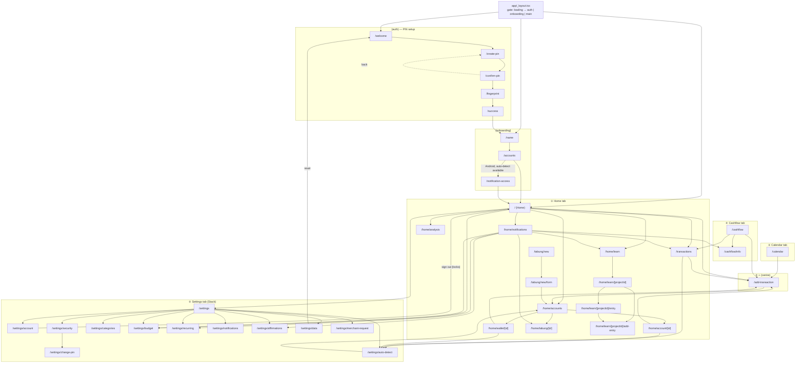

# Flowe — Full User Journey · v2

**Personal finance app · Expo SDK 54 (React Native) + expo-router 6 + Supabase · Android-first**
**Design system v2: light, navy→cobalt gradient, black `#020202` primary, white sheets (32 px top radius)**

> **v2 (2026-11-17)** regroups v1 by bottom-nav tab, adopts the new nav order **Home · Calendar · + · Cashflow · Settings**, ties every screen to its artboards on the "Flowe — Full App Redesign" canvas (Mobile page), and adds the designed-but-not-coded features (§6.7) and the canvas map (§8). Behaviour text is carried over from v1, which was rebuilt from the source code in `app/`. See §7 for exactly what changed.
> Where the code is ambiguous or unfinished, the text is marked **[unclear]** or **[stub]**. Where neither v1 nor the canvas says something, it is marked **[TBD]**.

**Conventions used in every screen section**

- **Route** is the expo-router pathname with groups removed (e.g. `app/(main)/home/accounts.tsx` → `/home/accounts`).
- **Locked?** says whether the route opens while the app is still PIN-locked. Only `/` and `/add-transaction` do (`src/utils/lockRoutes.ts`); every other `(main)` route raises the PIN overlay when it opens.
- **Nav** says whether the floating bottom nav is visible (`src/utils/navRoutes.ts` hides it on full-screen flows).
- **Design** lists the canvas artboards for the screen, its sheets and its states, as `<section letter> · <artboard title>` (letters from §8).
- Feedback always comes from the same three primitives: `ConfirmSheet` (destructive confirm), `InlineError` (validation), `useToast()` (success, or failure with Retry/Undo). The code has no `Alert.alert` calls. Their artboards live together in section **M**.

---

## 1. App map

> `/tabung/new` and `/tabung/new/form` have no incoming arrow because **nothing in the app navigates to `/tabung/new`** (see §5.1.7).

**Floating nav (5 items, left → right):** Home `/` · Calendar `/calendar` · **+** `/add-transaction` (centre) · Cashflow `/cashflow` (spending bubbles; net worth, assets and liabilities in `/cashflow/info`) · Settings `/settings`. [design change: code still uses Home | Cashflow | + | Calendar | Settings]

---

## 2. Startup and routing

### Root layout — `app/_layout.tsx`
- **Design:** A · splash; A · launch · after unlock · syncing; A · launch · cached data → live
- **Route:** wraps everything; no screen of its own.
- **Purpose:** decides which route group the user lands in, and mounts the global providers.
- **Providers (outer → inner):** `SafeAreaProvider` → `AuthProvider` → `OnboardingProvider` → `ToastProvider` → `Stack` (`(auth)`, `(onboarding)`, `(main)`, no headers).
- **On mount:** runs `resolve()`, `setupNotifications()` (local notifications) and `loadMerchantLogos()` (background refresh of the merchant-logo list; the bundled list is already in use).
- **Gate logic (`resolve`):**
  1. State becomes `loading` and `LaunchScreen` covers the app (it also stays up until the Inter fonts have loaded).
  2. Reads `flags.pinSet()` and `flags.onboardingDone()` from secure-store.
  3. `authRepository.getSession()`. If there's no session, it calls `signInAnonymously()`. A failure is logged and the app **continues offline**; there is no error state.
  4. No PIN → `auth`. PIN but onboarding not done → `onboarding`. Both done → `main`.
- **Redirects:** `auth` → `replace('/(auth)/welcome')`, `onboarding` → `replace('/(onboarding)/name')`, `main` → `replace('/(main)')`. Each fires only when the current top segment doesn't already match.
- **`refreshGate()`** (exported): re-runs `resolve()`. Called from `success`, `accounts`, `notification-access` and `settings/data` (reset).
- **Data:** `authRepository`, `flags` (`src/lib/secureStore`).

---

## 3. Onboarding journey

The **(auth)** group runs first (PIN), then **(onboarding)** (name + accounts).

### 3.0 Auth stack — `app/(auth)/_layout.tsx`
- `Stack` with no header, **swipe-back disabled** (`gestureEnabled: false`), fade animation. Screens: welcome, create-pin, confirm-pin, fingerprint, success.

### 3.1 Welcome — `app/(auth)/welcome.tsx`
- **Design:** B · (auth)/welcome
- **Route:** `/welcome`
- **Entry points:** root gate (no PIN set); `settings/data` after a full reset.
- **Purpose:** brand intro and the single "Get Started" call to action.
- **What's on screen:** full gradient; `BrandMark` with wordmark; headline "Know where every ringgit flows"; hero photo (`PhotoSlot welcomeHero`).
- **User actions:** **Get Started** (white pill) or the **→** icon button → `push('/(auth)/create-pin')`.
- **Sub-flows:** none.
- **Data:** none.
- **Exits:** create-pin.

### 3.2 Create PIN — `app/(auth)/create-pin.tsx`
- **Design:** B · (auth)/create-pin
- **Route:** `/create-pin`
- **Entry points:** welcome; confirm-pin (its back button `replace`s here).
- **Purpose:** enter a new 6-digit PIN.
- **What's on screen:** `PinEntryScreen`: gradient, title "Create your PIN", subtitle "6 digits. You'll use it every time you open Flowe.", 6 `PinDots`, glass `PinPad`.
- **User actions:** keypad digits and delete; back arrow (only if `router.canGoBack()`).
- **Behaviour:** on the 6th digit, after 200 ms → `push('/(auth)/confirm-pin', { firstPin })`, then the field clears.
- **Data:** local state only. The PIN is passed as a route param.
- **Exits:** confirm-pin; back.

### 3.3 Confirm PIN — `app/(auth)/confirm-pin.tsx`
- **Design:** B · (auth)/confirm-pin; B · (auth)/confirm-pin · mismatch
- **Route:** `/confirm-pin?firstPin=`
- **Entry points:** create-pin.
- **Purpose:** re-enter the PIN.
- **What's on screen:** `PinEntryScreen` titled "Confirm your PIN", subtitle "Enter the same 6 digits again."
- **User actions:** keypad; back → `replace('/(auth)/create-pin')`.
- **Behaviour:** on the 6th digit:
  - **Match:** `dispatch(SET_PIN)` into `OnboardingContext` → `replace('/(auth)/fingerprint')`.
  - **Mismatch:** glass chip "PINs don't match. Try again.", the dots shake (`errorKey`), and the field clears after 260 ms. Typing clears the error.
- **Data:** `useOnboarding()`.
- **Exits:** fingerprint; create-pin.

### 3.4 Fingerprint — `app/(auth)/fingerprint.tsx`
- **Design:** B · (auth)/fingerprint; B · (auth)/fingerprint · not set up
- **Route:** `/fingerprint`
- **Entry points:** confirm-pin.
- **Purpose:** optionally enable biometric unlock.
- **What's on screen:** gradient; `TopBar` with back; fingerprint icon in two glass rings; "Unlock with fingerprint" / "Open Flowe with a touch. Your PIN still works as a backup."; optional glass chip note.
- **User actions:**
  - **Enable** (white, shows a loader): checks `hasHardwareAsync` + `isEnrolledAsync`.
    - Not enrolled → note "No fingerprint set up on this phone. Your PIN will do." (stays on the screen).
    - System prompt "Enable fingerprint" succeeds → `SET_FINGERPRINT true` → `replace('/(auth)/success')`.
    - Prompt fails or is cancelled → note "Fingerprint not confirmed. Try again or skip."
  - **Skip** (text button) → `SET_FINGERPRINT false` → success.
  - **Back** → `router.back()`.
- **Data:** `expo-local-authentication`, `useOnboarding()`.
- **Exits:** success; back.

### 3.5 Success — `app/(auth)/success.tsx`
- **Design:** B · (auth)/success
- **Route:** `/success`
- **Entry points:** fingerprint.
- **Purpose:** persist the PIN, then move on to accounts.
- **What's on screen:** `ProgressRing` (sweeps to 100% once saved) around a check; "You're all set"; "Your PIN and fingerprint are ready." or "Your PIN is ready.".
- **Behaviour on mount (`persist`):** status `saving` → hashes the PIN (`hashPin`) → if there's a Supabase user, `authConfigRepository.upsert({ pinHash, fingerprintEnabled })` (a failure is only logged) → `flags.setPin(hash, fingerprint)` locally.
  - Local save fails → status `error` and toast "Couldn't save your PIN" with **Retry**.
  - Success → `CLEAR_PIN` from context → status `ready`.
- **User actions:** primary button **Set up my accounts** (shows a loader while saving; becomes **Try again** on error) → `refreshGate()` + `replace('/(onboarding)/name')`. The **→** icon button does the same and is enabled only when `ready`.
- **Data:** `authRepository`, `authConfigRepository`, `pinCrypto`, `flags`, `useOnboarding`.
- **Exits:** onboarding/name.

### 3.6 Onboarding stack — `app/(onboarding)/_layout.tsx`
- `Stack`, no header, swipe-back disabled, fade, white content background. Screens: name, accounts, notification-access.

### 3.7 Name — `app/(onboarding)/name.tsx`
- **Design:** C · (onboarding)/name
- **Route:** `/name`
- **Entry points:** success; the root gate (PIN set but onboarding unfinished).
- **Purpose:** capture the display name. This is **Step 1 of 2**.
- **What's on screen:** `HeroScreen` with `OnboardingHero` (back if possible, glass progress pill "Step 1 of 2", title "What should we call you?"); a large name input (auto-focused, 30-char max, words capitalised); helper "We'll use it on your home screen. Nothing else."; **Continue** (black).
- **User actions:** type a name; keyboard *done* or **Continue** → trims it. Empty → `InlineError` "Enter a name" (red outline). Otherwise `SET_NAME` → `push('/(onboarding)/accounts')`.
- **Data:** `useOnboarding()`. Nothing is written to Supabase yet.
- **Exits:** accounts; back.

### 3.8 Accounts — `app/(onboarding)/accounts.tsx`
- **Design:** C · (onboarding)/accounts · Bank; C · (onboarding)/accounts · E-wallet; C · (onboarding)/accounts · Tabung; C · BankDropdown · searchable sheet; C · (onboarding)/accounts · missing fields; C · (onboarding)/accounts · list
- **Route:** `/accounts`
- **Entry points:** name.
- **Purpose:** add draft bank / e-wallet / Tabung accounts. This is **Step 2 of 2**.
- **Two modes:**
  - **Adding** (the default when there are no drafts). Title "Add your first account" or "Add another account". Shows `AccountDraftForm`:
    - `SegmentedToggle` **Bank | E-wallet | Tabung** (switching resets the form).
    - Four tiles:
      - Bank: Maybank, CIMB and one more popular bank, plus **More banks** (opens the `BankDropdown` sheet; a bank picked there replaces the 4th tile).
      - E-wallet: TNG eWallet, GrabPay, ShopeePay.
      - Tabung: Emergency, Travel, Raya, Home.
    - **Account name** (auto-filled from the tile until the user edits it) and **Starting balance** (`AmountField`).
    - **Continue** validates. Missing tile → "Choose your bank / e-wallet / a goal type". Missing name → "Give this account a name" (focuses the field). Missing amount → "Enter a starting balance (0 is fine)" (focuses the field).
    - On success: success haptic, `ADD_DRAFT`, and the form switches to the list.
    - A Tabung draft gets `target: 0`, runs from today to one year out, and its starting amount equals the entered balance.
  - **List.** Title "Your accounts". Header "N account(s) added". Each `DraftAccountCard` shows logo, name, type and balance, with **×** to remove (`REMOVE_DRAFT`). Below: a dashed **Add another** button (back to adding mode), then the primary button: **Continue** when there's at least one draft, otherwise **Skip for now**.
- **Back:** in adding mode with existing drafts, back returns to the list; otherwise `router.back()`.
- **Finish (`finish`):**
  - Native auto-detect available (Android dev build) → `push('/(onboarding)/notification-access')`.
  - Otherwise → `completeOnboarding(name, drafts)`. This updates `profiles.display_name`, creates each account, then sets `flags.markOnboardingDone()`.
    - Failure → toast "Something went wrong" with Retry.
    - Partial failure → toast "Couldn't add N account(s)".
    - Then `refreshGate()` + `replace('/(main)')`.
- **Sub-flows:** `BankDropdown` sheet (full bank list).
- **Data:** `useOnboarding`, `useCompleteOnboarding` → `src/services/onboarding.ts` → `accountsRepository.create*Account`, `profilesRepository.update`.
- **Exits:** notification-access; `/(main)`; back to name.

### 3.9 Notification access — `app/(onboarding)/notification-access.tsx`
- **Design:** C · (onboarding)/notification-access
- **Design gap:** no artboard yet for "returned from system settings, access still off" (see the [unclear] below). [TBD]
- **Route:** `/notification-access`
- **Entry points:** accounts (only when `FloweNotifications.isAvailable`).
- **Purpose:** ask for Android notification-listener access so auto-detect can work.
- **What's on screen:** hero with an illustration: a fake Maybank alert "You spent RM 12.50 with your card." → arrow → "RM 12.50 · one tap to log [Confirm]". Title "Let Flowe read bank alerts". Three points: only reads alerts from the banks and wallets you added; parsed on the phone and nothing is sent; you confirm each one and can turn it off in Settings.
- **User actions:**
  - **Allow** → `FloweNotifications.openSettings()` (the system listener settings page). When the app comes back to the foreground **with permission granted**, it calls `setEnabled(true)` and runs `finish()` automatically.
  - **Later** (text button) → `finish()` without turning auto-detect on.
- **`finish()`:** same as accounts: `completeOnboarding` → toasts on failure → `refreshGate()` → `replace('/(main)')`.
- **Conditional:** coming back from settings **without** granting access does nothing; the user stays here. **[unclear]** There's no on-screen hint that access is still off.
- **Data:** `FloweNotifications` native module, `useCompleteOnboarding`.
- **Exits:** `/(main)`.

---

## 4. Auth, PIN and biometric journey inside the app

Initial PIN setup is covered in §3.1–3.5. This section covers locking once the user is inside `(main)`.

### 4.1 Deferred lock (`context/LockContext.tsx`)
- **Design:** D · home · locked
- A cold start begins **locked**. Locked is a "not yet verified" flag, not a wall:
  - **Home** (`/`) works with every money figure **masked** (`RM •••••`), and its balance shows a "Locked · tap to show" chip.
  - **Add transaction** works fully. In the account picker, balances are masked.
  - **Any other route** → `LockedRouteGuard` (in `(main)/_layout.tsx`) calls `requireUnlock()`, which shows the overlay. Backing out of the overlay → `router.back()`, or `replace('/(main)')` if there's nowhere to go back to.
- Tapping a transaction on Home, or the masked balance, also calls `requireUnlock()`.
- **Auto-lock:** when the app goes to the background, the time is recorded. On return it re-locks if the Settings → Security "Lock after" time has passed (1 / 5 / 15 min, or never). The value is re-read from `auth_config` on each background event.
- `suspend()` skips the next re-lock check. It's used before opening the camera, image or document picker, system settings, the share sheet or a PDF link, so coming back from those never asks for the PIN.
- **Lock manually:** Settings → Account → "Sign out of this device" calls `lock()` (see 5.5.2). Home has no padlock button. **[unclear]** `LockContext` still describes "the padlock on the home screen", but no such button is rendered.

### 4.2 Lock overlay (`components/home/LockOverlay.tsx`)
- **Design:** A · lock · re-open; A · lock · wrong PIN
- Full-screen gradient on top of everything (z-index 200): BrandMark; "Welcome back, {name}"; "Enter your PIN or use fingerprint" (or "Enter your PIN"); 6 dots; glass numpad with a fingerprint key when biometrics are on.
- If fingerprint is enabled, enrolled and supported, the system prompt "Unlock Flowe" (fallback "Use PIN") opens **automatically**.
- The PIN auto-submits on the 6th digit through `verifyPin`. Wrong → dots shake, glass chip "Wrong PIN. Try again.", and the field clears. Right → unlocked, and the pending `requireUnlock()` resolves `true`.
- Android **back** → cancel; `requireUnlock()` resolves `false`.

### 4.3 Launch sync (`components/home/LaunchSync.tsx`)
- **Design:** A · launch · after unlock · syncing; A · launch · cached data → live; M · Live Update · Syncing…
- Over `(main)` on launch: the splash shows a thin progress bar, "Syncing…" → "Syncing N accounts…" (from `fetchAllActive`). It's capped at **1.5 s**, then fades. Home shows cached figures with "Updating…" until live data arrives.

---

## 5. Main app

The main app is grouped by bottom-nav tab, in nav order: **§5.1 Home · §5.2 Calendar · §5.3 + Add transaction · §5.4 Cashflow & net worth · §5.5 Settings**. Each screen sits under the tab whose nav item is active while it is open (see `navKeyFor` in §5.0); add-transaction hides the nav.

### 5.0 Main layout — `app/(main)/_layout.tsx`
- **Navigator:** `Tabs` with `tabBar={() => null}`. All 19 non-settings routes plus the `settings` stack are registered as **hidden** tabs (`href: null`), so navigation happens only through the custom `FloatingNav` and `router` calls.
- **Mounted on top of every (main) screen:**
  - `FloatingNav`: a pill inset 24 px from the edges, with a white fade under it. The active item is a black circle. Items, left → right: **Home, Calendar, + (Add transaction, centre), Cashflow, Settings** → `router.navigate(...)`. [design change: code still uses Home | Cashflow | + | Calendar | Settings] The active item comes from `navKeyFor(pathname)`: `/cashflow*` → Cashflow, `/calendar*` → Calendar, `/settings*` → Settings, everything else → Home. **The + item is never shown as active.** [unclear] On add-transaction itself the nav is hidden anyway.
  - The nav is **hidden** on `/add-transaction`, `/settings/change-pin`, `/settings/merchant-request`, `/tabung/new`, `/tabung/new/form`, `/home/learn/[id]/add-entry` and `/home/learn/[id]/entry`.
  - `DetectedTransactionOverlay`: the auto-detect **island** (§6.1).
  - `LockedRouteGuard` (§4.1).
  - `LaunchSync` (§4.3).
- **Providers:** `LockProvider` → `DetectedTransactionsProvider`.
- **Side effect:** `startDailyBudgetSync()`. Every transaction write redraws the budget widgets and the live budget notification.

---

### 5.1 Home tab

Everything reached from the Home dashboard. The nav shows **Home** active on all of these routes.

#### 5.1.1 Home dashboard — `app/(main)/index.tsx`
- **Design:** D · home; D · home · locked; D · home · scrolled; D · home · 3+ pending; D · modal · recurring due; D · modal · recurring · one by one; D · transaction/[id] · sheet; L · home · live · before confirm; L · home · live · after confirm; M · home · empty; M · home · loading; M · home · error; M · home · pull to refresh; M · home · toast saved; M · transaction · delete
- **Route:** `/` · **Locked?** open (figures masked) · **Nav:** yes (Home active)
- **Entry points:** root gate; FloatingNav Home; onboarding finish; LockedRouteGuard fallback; add-transaction "Done" (via back); Settings → Account sign-out.
- **Purpose:** balance, today's spend, items waiting for review, recent activity.
- **What's on screen (top → bottom, phone):**
  1. **Hero (gradient, `HomeHero`):**
     - Avatar circle with the user's initial → `/settings`. Bell (with a dot when there are unread notifications) → `/home/notifications`.
     - "Balance" (or "Balance · last synced {time}" when showing saved data), then the total of spendable accounts. The figure counts down to new values.
     - Status chip, in priority order: "Locked · tap to show" (taps to unlock) → "Updated just now" (for 2 s after any transaction write) → "Updating…" (cached figures) → "Showing saved data" (fetch error) → "No accounts yet" → "±x.xx% this month" (net income vs the balance at the start of the month). Nothing shows if none apply.
     - Stacked glass account cards: the lead account (first bank, else first wallet) with its logo, name and mask, plus up to 2 more logos and "+N". The whole stack → `/home/accounts`.
  2. **Action row:**
     - **Add** → `/add-transaction?nonce`.
     - **⇅** (Transfer) → `/add-transaction?type=transfer&nonce`.
     - **Scan** → `/add-transaction?scan=1&nonce` (opens the camera straight away).
  3. **Pending detections card** (`PendingEntriesCard`), only when the auto-detect queue has unfiled items (§6.1).
  4. **Stat tiles:** "Spent today" and "Left today". With no daily budget, the second tile reads "Set a budget" and taps → `/settings/budget`.
  5. **Recent Transactions** (5 most recent expense / income / transfer rows this month). Header action → `/transactions`. Tapping a row → `requireUnlock()` → `TransactionDetail` sheet.
  6. **Today's affirmation** gradient card (the user's active affirmations first, then the stock ones). Tapping shows the next one (only if there's more than one).
  7. **Links:** chips **Analysis** → `/home/analysis` and **Learn** → `/home/learn`.
- **Tablet:** items 3, 4, 6 and 7 sit in the left column and Recent Transactions in the right.
- **Loading state:** skeleton pills, card and tiles (first load with no cache).
- **Empty state (no accounts):** photo + "Add your first account" / "Connect a bank, e-wallet or Tabung and Flowe starts counting from today." → **Add account** → `/home/accounts?add=1` (opens the add sheet).
- **Error states:**
  - Balances fail with no accounts loaded → "Couldn't refresh balances" (shows the saved time if cached) → **Try again**.
  - Transactions fail → "Couldn't load transactions" → **Try again**.
  - No transactions → "No transactions yet / Add one, or turn on auto-detect…" → **Add transaction**.
- **Pull to refresh:** reloads everything and refreshes today's spend.
- **Sub-flows:**
  - **TransactionDetail sheet** (shared component, used on 5 screens):
    - Merchant logo, name, signed amount; rows for Category, Account (or "From → To" for transfers), Date · time, Note; receipt photo (signed URL) if there is one.
    - **Edit** → closes, then `/add-transaction` with `editParams(tx)` (`editId`, type, name, amount, category, accounts, asset, date, note).
    - **Delete** (text button) → `ConfirmSheet` "Delete this transaction?" ("RM x at {name} will be removed. {balance effect}") → deletes → local notification plus an in-app notification row "Transaction deleted" → toast "Transaction deleted" with **Undo** (re-creates the row; toast "Transaction restored"). A failed delete → toast with Retry.
  - **PendingRecurringModal** (opens **automatically once** per Home mount when the app is unlocked and recurring bills are due):
    - Header "N recurring bill(s) due · Today · from {account}". Every bill is pre-ticked, with a signed total.
    - **Confirm all** / **Confirm N** → approves each ticked bill, creating its transaction. The sheet closes if all were ticked.
    - **Review one by one** → one bill at a time with **Confirm** or **Skip this one** (skips this period).
    - It can't be dismissed while it's working.
- **Background work on Home:**
  - Reads and writes a home cache of the last balance.
  - Pushes budget limits to native (`syncBudgetLimits`).
  - Schedules recurring reminders once per session.
  - Live update on `changedAt` from `useTodaySpend`.
- **Data:** `useAccounts`, `useTransactions(year, month)`, `useBudgetSettings`, `useTodaySpend`, `usePendingRecurring`, `useAffirmations`, `useCustomCategories`, `useProfile`, `useDetected`, `notificationsRepository.getUnreadCount`.
- **Exits:** every link above; FloatingNav.

#### 5.1.2 Transactions list — `app/(main)/transactions.tsx`
- **Design:** D · transactions; D · transactions · search; D · transactions · category filter; D · transaction/[id] · sheet; M · transactions · empty; M · transactions · loading; M · transactions · error
- **Route:** `/transactions?category=&month=YYYY-MM` · **Locked?** PIN required · **Nav:** yes
- **Entry points:** Home "Recent Transactions" header; Cashflow "Expenses" header; Cashflow bubbles and tiles (`category` + `month`); notifications for expense, income and transfer items.
- **Purpose:** the full month list, optionally filtered by expense category and searchable.
- **What's on screen:** hero titled "Recent Transactions" (or the category label), back, a **search** toggle (🔍/×); the search field "Search name, category or note"; the transaction list.
- **Loading / empty / error:**
  - "Couldn't load transactions" → **Try again**.
  - No transactions → "No transactions yet / Turn on auto-detect…" → **Turn on auto-detect** → `/settings/auto-detect`.
  - Nothing matches the search → "Nothing matches".
- **Sub-flows:** TransactionDetail (Edit → add-transaction; delete with Undo).
- **Data:** `useTransactions(year, month)`, `useAccounts`, `useCustomCategories`.
- **Exits:** back; add-transaction; settings/auto-detect.

#### 5.1.3 Accounts list — `app/(main)/home/accounts.tsx`
- **Design:** E · home/accounts; E · home/accounts · add account; C · BankDropdown · searchable sheet; M · home/accounts · loading
- **Route:** `/home/accounts?add=1` (optional) · **Locked?** PIN required · **Nav:** yes
- **Entry points:** the Home hero account stack; Home empty state (`add=1`); the AccountSelector "Add account" button in add-transaction; Settings → Auto-detect "Add an account first" (`add=1`); `tabung/new/form` (`dismissTo`); notifications for tabung/milestone items with no related id.
- **Purpose:** all accounts, grouped by type, plus adding new ones.
- **What's on screen:**
  - Hero: back; **+** (add account); "Net worth in accounts" (sum of all balances, masked when locked); chip "N accounts · M Tabung".
  - Groups **Banks / E-wallets / Tabung** with group totals.
  - Each row: logo or icon, name, meta, balance. Meta is the account mask plus "auto-detect on" if a detection source is pinned to it; for a Tabung it's "Target RM x". Tapping a row → bank `/home/account/[id]`, wallet `/home/wallet/[id]`, Tabung `/home/tabung/[id]`.
- **Loading / empty / error:** grouped skeletons. Empty: "No accounts yet" → **Add account**. Error: "Couldn't load accounts" → **Try again**.
- **Sub-flows:** **Add account sheet** with the same `AccountDraftForm` as onboarding (Bank / E-wallet / Tabung; the submit label is "Add account" or "Adding…"). It runs `createAccountFromDraft` → toast "Account added" or "Tabung created · {name}" → reloads the list. A failure → toast with Retry. The sheet can't be dismissed while saving.
- **Conditional:** a Tabung created here gets **target 0** and a one-year date range. Its detail screen then offers "Set a target".
- **Data:** `useAccounts`, `createAccountFromDraft`, `sourceAccounts.all()` (auto-detect pins), `FloweNotifications`.
- **Exits:** detail screens; back.

#### 5.1.4 Bank account detail — `app/(main)/home/account/[id].tsx`
#### 5.1.5 E-wallet detail — `app/(main)/home/wallet/[id].tsx`
- **Design:** E · home/account/[id]; E · account/[id] · ⋯ menu; E · account/[id] · edit details; E · account/[id] · filter; E · home/wallet/[id]; M · account/[id] · loading; M · account/[id] · delete; M · wallet/[id] · delete; M · wallet/[id] · top up failed
Both are thin wrappers around `components/accounts/AccountDetailScreen.tsx`, with `kind="bank"` and `kind="wallet"` respectively.
- **Route:** `/home/account/[id]` and `/home/wallet/[id]` · **Locked?** PIN required · **Nav:** yes
- **Entry points:** the accounts list; add-transaction (`returnTo`) after saving from this screen; edits made from this screen's TransactionDetail.
- **Purpose:** one account's balance, this month's in/out, and its history.
- **What's on screen:**
  - Hero: back; **⋯** menu; logo; name; balance; chips: mask/"Bank" or "E-wallet", plus **Auto-detect** (taps → `/settings/auto-detect`).
  - Stat tiles: "In · {Mon}" and "Out · {Mon}" (this month, transfers included by direction).
  - **History** header, whose action button reads Filter / Money in / Money out. Rows are grouped by day ("Today", etc.) with category · time. Tapping a row → TransactionDetail.
- **Loading / empty / error:** skeleton rows. Empty: "Nothing here yet". Error: "Couldn't load history" → **Try again**.
- **Sub-flows:**
  - **⋯ menu sheet:**
    - **Edit details** (Name, balance, plus last 4 digits for banks) → Edit sheet.
    - **Add transaction** → `/add-transaction?presetAccountId=…&returnTo=/home/{account|wallet}/{id}`.
    - **Auto-detect** → `/settings/auto-detect`.
    - **Delete account** → PIN-confirm sheet.
  - **Edit account sheet:** Name, Balance (RM), and for banks "Last 4 digits (matches bank alerts)". Validation: "Name is required" / "Enter a valid balance". Save updates the name, the balance (`updateBankBalance` / `updateWalletBalance`, only if changed) and the last 4 digits → toast "Account updated".
  - **Delete ConfirmSheet:** "Delete {name}? It leaves your accounts and totals. Its N transactions stay in your history. Enter your PIN to confirm." It includes a 6-digit PIN field, and confirm stays disabled until 6 digits are in. Wrong PIN → "Wrong PIN. Try again." Right PIN → `softDeleteAccount` → toast "{name} deleted" → back.
  - **Filter sheet "Show":** All / Money in / Money out.
  - **TransactionDetail:** Edit → add-transaction with `returnTo` set to this screen.
- **Data:** `useAccounts`, `useAccountTransactions(accountId)`, `accountsRepository`, `verifyPin`.
- **Exits:** back; add-transaction; settings/auto-detect.

#### 5.1.6 Tabung detail — `app/(main)/home/tabung/[id].tsx`
- **Design:** E · tabung/[id]; E · tabung/[id] · no target yet; E · tabung/[id] · add money; E · tabung/[id] · progress keeps moving; E · tabung/[id] · monthly breakdown sheet; E · tabung/[id] · progress setting; E · tabung/[id] · add money; E · tabung/[id] · pay out; E · tabung/[id] · goal reached; M · tabung/[id] · loading; M · tabung/[id] · delete
- **Route:** `/home/tabung/[id]` · **Locked?** PIN required · **Nav:** yes
- **Entry points:** the accounts list (Tabung rows); notifications of type `tabung` / `milestone` that have a `related_entity_id`.
- **Purpose:** savings-goal progress, adding money, paying out.
- **What's on screen:**
  - Hero: back; title = Tabung name; **sliders** icon → Settings sheet.
  - `ProgressRing` with "Saved toward goal" or "In Tabung now" (depends on progress mode), the counted amount, and "of RM target · n%".
  - Status chip:
    - No target → "Set a target" (opens Settings with the target field focused).
    - Reached → "Goal reached · {Mon YYYY}".
    - Otherwise → "RM x/month · done by {Mon YYYY}" or "Target · {Mon YYYY}".
  - Card "Saved toward goal" (contributed total, plus "Every top-up counts. Pay-outs never move this back." or "Goal reached in N months.").
  - Stat tiles "In Tabung now" and "Paid out".
  - "This goal by month" with a **Breakdown** action; `TabungMonthStrip`, including a projected month when the goal isn't reached and months remain. With no top-ups: "Your first top-up starts the month strip."
  - Buttons **Add money** and **Pay out** (disabled when the balance is 0).
- **Loading / error:** skeletons; "Couldn't load this Tabung" → **Try again**.
- **Sub-flows:**
  - **TabungMoneySheet** (full-screen modal, `mode` in/out):
    - Title "Add to {name}" or "Pay out of {name}"; numpad amount.
    - Chips: "Progress a% → b%" for top-ups; for pay-outs, "Progress stays at a%" plus "Balance x → y".
    - From/To account pill (opens an AccountSelector titled "Add from" / "Pay out to"). The default account is the last one used for this Tabung, otherwise the most-used funding account, otherwise the first spendable account.
    - Quick-amount chips: the usual amount, plus the on-track monthly figure for top-ups.
    - Pay-out note: "Paying out lowers the balance only…"
    - Submit creates a `tabung_topup` or `tabung_withdraw` transaction → in-app notification "Tabung top-up" / "Tabung pay-out" → toast "Added RM x to {name}" or "Paid out RM x". A failure → toast "…failed · nothing was moved" with Retry.
  - **TabungBreakdownSheet** "{name} by month": per-month amounts toward the goal.
  - **TabungSettingsSheet** "Count progress by":
    - Two radio cards: **Total saved in (default)** or **Current balance**, each showing "Now: RM x · n%".
    - Name; Target. Validation: "Give this Tabung a name" / "Set a target above RM 0.00".
    - **Save** → `updateTabungGoal` → toast "Tabung updated".
    - **Delete Tabung** → delete confirm.
    - When opened from "Raise the target", shows the hint "Raise the target to keep this goal going."
  - **Delete ConfirmSheet** "Delete {name}?":
    - If there's money in it: "RM x saved moves back to {account}…" with an account pill (opens AccountSelector "Move the money to"). Confirm is disabled until an account is chosen.
    - On confirm: creates a `tabung_withdraw` "Closed · {name}" for the saved amount → `softDeleteAccount` → clears the Tabung widget → toast "{name} deleted" → back.
  - **Goal reached sheet** (opens automatically when `progress.reached`): a summary of contributed and paid-out amounts → **Raise the target** (Settings with target focus) or **Keep it as is**.
- **Side effects:** pushes this Tabung to the Android home-screen Tabung widget (`setTabungWidget`) on every progress change.
- **Data:** `useTabungProgress(id)`, `useAccounts`, `transactionsRepository`, `accountsRepository`, `readLastUsed` / `writeLastUsed`, `notify`.
- **Exits:** back.

#### 5.1.7 New Tabung · goal — `app/(main)/tabung/new/index.tsx`
- **Design:** E · tabung/new
- **Tab:** listed under Home because a created Tabung lands in Accounts (§5.1.3). The route is still unreachable, see below.
- **Route:** `/tabung/new` · **Locked?** PIN required · **Nav:** hidden
- **Entry points:** **none found. [unclear] The route is registered and fully built, but no screen, notification or link calls `/tabung/new`.** Tabung are currently created through the Bank / E-wallet / **Tabung** tab of `AccountDraftForm` (onboarding, or the Accounts → Add account sheet).
- **Purpose:** step 1, picking a goal type.
- **What's on screen:** close (×); "What are you saving for?"; radio cards for **Emergency** (3–6 months of spend), **Travel** (Trips and holidays), **Raya & festive** (Duit raya, balik kampung), **Education** (Fees, courses), **Home** (Deposit, renovation), **Custom** (Anything else). The default is Emergency.
- **User actions:** pick a card; **Continue** → `/tabung/new/form?goal=<key>`.
- **Data:** `TABUNG_GOALS` constant.
- **Exits:** form; close.

#### 5.1.8 New Tabung · details — `app/(main)/tabung/new/form.tsx`
- **Design:** E · tabung/new/form
- **Route:** `/tabung/new/form?goal=` · **Locked?** PIN required · **Nav:** hidden
- **Entry points:** `/tabung/new`.
- **Purpose:** step 2: name, target and target date.
- **What's on screen:** back; title = the typed name (or the goal label); Name (pre-filled from the goal's default name); Target (`AmountField`); a target-date pill (default 31 Dec of next year; native date picker with a minimum of today); **Create Tabung**.
- **Validation:** "Give this Tabung a name"; "Set a target above RM 0.00".
- **Save:** `createTabungAccount` (from today to the chosen date, icon and template = goal) → toast "Tabung created · {name}" → `router.dismissTo('/home/accounts')`. A failure → toast with Retry.
- **Data:** `useAccounts().createTabungAccount`.
- **Exits:** accounts list; back.

#### 5.1.9 Notifications inbox — `app/(main)/home/notifications.tsx`
- **Design:** F · home/notifications; F · home/notifications · unread; F · home/notifications · all read; M · home/notifications · all caught up
- **Route:** `/home/notifications` · **Locked?** PIN required · **Nav:** yes
- **Entry points:** the Home bell.
- **Purpose:** the in-app notification feed.
- **What's on screen:**
  - Hero: back; **✓** "Mark all read" (disabled when nothing is unread).
  - Groups **Today / Earlier**. Each row: type icon, message (bold if unread), sub-text, relative time (now / Nm / HH:MM / weekday / d Mon), and an unread dot.
- **User actions:** tapping a row marks it read and opens its source:
  - expense / income / transfer → `/transactions`
  - recurring → `/settings/recurring`
  - alert → `/settings/budget`
  - tabung / milestone → `/home/tabung/[related id]`, or `/home/accounts` if there's no id
  - asset / liability / cashflow → `/cashflow/info`
  - note / project → `/home/learn`
  - affirmation → `/settings/affirmations`
- **Loading / empty / error:** skeletons. Empty: "You're all caught up". Error: "Couldn't load notifications" → **Try again**. A failed mark-all → toast with Retry.
- **Data:** `useNotifications` (`fetchNotifications`, `markAsRead`, `markAllRead`).
- **Exits:** the routes above; back.

#### 5.1.10 Analysis — `app/(main)/home/analysis.tsx`
- **Design:** F · home/analysis; M · home/analysis · empty; M · home/analysis · loading
- **Route:** `/home/analysis` · **Locked?** PIN required · **Nav:** yes
- **Entry points:** the Home "Analysis" chip.
- **Purpose:** monthly spend trend and income vs expense.
- **What's on screen:**
  - Hero: back; "Spent in {Month}" plus the amount; chip "x.x% less / more than {previous month}".
  - **Monthly trend:** a bar chart of expenses. The header action cycles **6M → 12M → 3M**. The current month is the solid bar.
  - **Income vs expense:** two bars, plus "You kept n% of income this month." or "You spent n% more than you earned this month."
- **Loading / empty / error:** skeleton bars. With no data: "Your first month of spending starts the trend." Error: "Couldn't load analysis" → **Try again**.
- **Sub-flows:** none.
- **Data:** `useAnalysis(ym)` → `analysis-monthly` Edge Function.
- **Exits:** back.

#### 5.1.11 Learn · projects — `app/(main)/home/learn/index.tsx`
- **Design:** F · home/learn; F · home/learn · new project; M · home/learn · empty; M · home/learn · loading
- **Route:** `/home/learn` · **Locked?** PIN required · **Nav:** yes
- **Entry points:** the Home "Learn" chip; project screen back / after delete (`replace`); notifications for note and project items.
- **Purpose:** a list of the user's learning-note projects.
- **What's on screen:** hero with back, **+** (new project), "N projects", and "N entries · last on {weekday}"; a grid of project cards (the first 3 get cover photos) showing name and entry count.
- **Loading / empty / error:** skeleton cards. Empty: "Start a learning project / Keep notes on what you learn about money…" → **New project**. Error: "Couldn't load your projects" → **Try again**.
- **Sub-flows:** **New project sheet:** "Project name" (placeholder "e.g. Budgeting 101") → **Create project** → navigates straight into the new project. A failure → toast with Retry.
- **Data:** `useLearn` (`fetchProjects`, `createProject`).
- **Exits:** `/home/learn/[projectId]`; back.

#### 5.1.12 Learn · project — `app/(main)/home/learn/[projectId].tsx`
- **Design:** F · home/learn/[projectId]; F · learn/[projectId] · rename; M · learn/[projectId] · delete
- **Route:** `/home/learn/[projectId]` · **Locked?** PIN required · **Nav:** yes
- **Entry points:** the Learn list; creating a project; entry screen back / after delete (`replace`); add-entry after saving a **new** entry (`replace`).
- **Purpose:** a project's entries.
- **What's on screen:** a cover-photo hero; back (→ `replace('/home/learn')`); **⋯**; the project name; chip "N entries". **Entries** are listed (title or "Untitled", created date, an icon for photo vs PDF). **Add entry** button.
- **User actions:** tap an entry → `/home/learn/[projectId]/entry?entryId=`; **Add entry** → `/home/learn/[projectId]/add-entry?entryId=` (empty).
- **Loading / empty / error:** skeletons. Empty: "No entries yet. Add your first note below." Error: "Couldn't load entries" → **Try again**.
- **Sub-flows:**
  - **⋯ menu:** **Rename project** / **Delete project**.
  - **Rename sheet:** project name → **Save**. A failure → toast with Retry.
  - **Delete ConfirmSheet:** "Its N entries are deleted with it. This can't be undone." → toast "{name} deleted" → `replace('/home/learn')`.
- **Data:** `useLearnProject(projectId)` (`rename`, `remove`, `refresh`).
- **Exits:** entry; add-entry; Learn list.

#### 5.1.13 Learn · new / edit entry — `app/(main)/home/learn/[projectId]/add-entry.tsx`
- **Design:** F · learn/[projectId]/add-entry; M · settings/data · file too large
- **Route:** `/home/learn/[projectId]/add-entry?entryId=` (an empty `entryId` means new) · **Locked?** PIN required · **Nav:** hidden
- **Entry points:** the project's **Add entry** button; the entry screen's **Edit** button or menu item.
- **Purpose:** write a note with photo and PDF attachments.
- **What's on screen:** close (×); title "New entry" or "Edit entry"; **Title**; read-only pills for the date (Today, or the created date) and the project name; **Notes** (multi-line); attachment thumbnails (up to **10**) with a remove **×** on each; buttons **Photo** and **PDF**; **Save entry**.
- **User actions:**
  - **Photo:** asks for media-library permission (denied → toast "Photo access is off" with Try again) → multi-select picker.
  - **PDF:** document picker. Files over **10 MB** are rejected (toast "File too large · max 10 MB" with Pick another); an unreadable file → toast "Couldn't read that file".
  - Remove an attachment (existing ones are queued for deletion).
- **Validation:** no title, notes or files → "Add a title or a note".
- **Save:** create or update the entry body (title + notes joined) → delete removed attachments (row + storage) → upload new ones to `learn-images/{user}/{entry}/{uuid}.jpg|pdf` and attach them.
  - Toasts: "Entry saved" / "Entry updated", or "Some attachments couldn't be removed", or "N attachment(s) didn't upload".
  - Then `replace` → the entry screen (when editing) or the project screen (when new).
- **Data:** `learnRepository`, `storageService`, `expo-image-picker`, `expo-document-picker`, `useLock().suspend`.
- **Exits:** entry or project (`replace`); back.

#### 5.1.14 Learn · entry — `app/(main)/home/learn/[projectId]/entry.tsx`
- **Design:** F · learn/[projectId]/entry; M · learn/[projectId]/entry · delete
- **Route:** `/home/learn/[projectId]/entry?entryId=` · **Locked?** PIN required · **Nav:** hidden
- **Entry points:** the project entry list; add-entry after saving an edit.
- **Purpose:** read one entry.
- **What's on screen:** back (→ `replace` the project); **⋯**; "{Project} · {date}"; the title; notes split into paragraphs; a photo grid; PDF rows (tap → opens the signed URL in an external app); **Edit**; **Delete** (text button).
- **User actions:** **Edit** → add-entry with this `entryId`. Opening a PDF calls `suspend()` first. Errors: "Couldn't open the file" / "No app on this phone can open the PDF".
- **Sub-flows:**
  - **⋯ menu:** **Edit entry** / **Delete entry**.
  - **Delete ConfirmSheet:** "'{title}' and its attachments are removed from {project}." → toast "Entry deleted" → back to the project.
- **Empty:** "This entry no longer exists."
- **Data:** `useLearnProject` (`entries`, `imageUrls`, `deleteEntry`).
- **Exits:** project; add-entry.

---

### 5.2 Calendar tab

#### 5.2.1 Calendar — `app/(main)/calendar.tsx`
- **Design:** G · calendar; G · calendar · day sheet; M · calendar · loading
- **Route:** `/calendar` · **Locked?** PIN required · **Nav:** yes (Calendar active)
- **Entry points:** FloatingNav.
- **Purpose:** spending by day for a month.
- **What's on screen:**
  - Hero: ‹ › month buttons, "{Month YYYY}", "Spent this month" plus the total.
  - A 7-column grid (S M T W T F S). Each day shows 0–3 dots for its spend level. Today is a black circle; future days are muted.
  - Legend: "Dots = spend level (1–3) · Today = black".
- **User actions:** change month; tap any day → day sheet; pull to refresh.
- **Loading / error:** skeleton cells; "Couldn't load this month" → **Try again**.
- **Sub-flows:**
  - **Day sheet:** the date, the day's spend, that day's transactions (tap → closes the sheet and opens TransactionDetail) or "Nothing on this day.", and **Add to this day** → `/add-transaction?date=YYYY-MM-DD`.
  - **TransactionDetail** (Edit → add-transaction).
- **Data:** `useTransactions(month)`, `useAccounts`, `useCustomCategories`.
- **Exits:** add-transaction; FloatingNav.

---

### 5.3 + Add transaction (centre)

The centre nav item. It is never shown as active, and the nav is hidden while this screen is open.

#### 5.3.1 Add / edit transaction — `app/(main)/add-transaction.tsx`
- **Design:** H · add-transaction · 1 amount; H · add-transaction · 2 category; H · add-transaction · all categories; H · add-transaction · optional note; H · add-transaction · transfer; H · AccountSelector · sheet; H · add-transaction · reading receipt; H · add-transaction · edit; H · add-transaction · 4 success; M · add-transaction · invalid amount; M · add-transaction · missing account; M · add-transaction · not enough balance; M · add-transaction · transfer same account; M · add-transaction · transfer missing destination; M · add-transaction · Save loading; M · add-transaction · save failed
- **Route:** `/add-transaction` with optional params: `editId`, `type` (expense|income|transfer), `name`, `amount`, `category`, `fromAccountId`, `toAccountId`, `assetId`, `date`, `note`, `nonce`, `presetAccountId`, `returnTo`, `scan=1`. · **Locked?** open · **Nav:** hidden
- **Entry points:**
  - FloatingNav **+** and the Home **Add** button.
  - Home **⇅** (`type=transfer`) and **Scan** (`scan=1`).
  - Home and Transactions empty states; Cashflow empty state.
  - Calendar day sheet "Add to this day" (`date`).
  - Account detail menu (`presetAccountId`, `returnTo`).
  - **Edit** in any TransactionDetail (`editId` + fields).
  - The form resets whenever `nonce` or `editId` changes.
- **Purpose:** record an expense, income or transfer (including transfers into an asset, i.e. investments).
- **Defaults:** Expense; the last-used account (or the last transfer from/to pair); Today. Edit mode pre-fills everything from the params.
- **What's on screen:**
  - **Hero:** close (×); title "Add transaction" or "Edit transaction"; `SegmentedToggle` **Expense | Income | Transfer** (switching clears the category, and clears the destination unless switching to Transfer); a big amount display; an amount error; chip "Reading receipt…" or "Receipt attached".
  - **Sheet:**
    - Expense/Income: a horizontal row of the 6 most-used category chips (plus the selected one if it isn't among them) and **More** (opens the "All categories" sheet).
    - Transfer: **From pill → To pill**.
    - Account pill (expense/income); date pill (Today / Yesterday / d Mon); **+ Note** (reveals a 200-char note field).
    - `Numpad` and the **Save** button.
- **Smart behaviour:**
  - Expense with no category chosen + a typed name → the category is guessed from the merchant.
  - The Save label changes with validation state: "Enter an amount", "Amount too large", "Choose an account", "Choose a destination", "Choose a different account", "Not enough balance", "Choose a category", or "Save".
  - Validation messages: "Enter an amount above RM 0.00"; "Amounts go up to RM …"; "Add an account first, then save."; "Choose where the money goes."; "Pick two different accounts."; "{account} has RM x available." (when locked: "…doesn't have enough for this.").
- **Receipt scan:** asks for camera permission (denied → toast "Camera access is off" with Try again) → `suspend()` → camera → the `receipt-ocr` Edge Function. It fills the total, the merchant (and resets the category) and the date (only if not in the future), and forces Expense. An unreadable receipt → toast "Couldn't read that receipt. The photo is attached."
- **Save:**
  - Builds the payload and runs `create` or `update`. If the save takes longer than 4 s, it shows toast "Save failed. Your entry is kept." with Retry.
  - Transfer to an asset: sets `asset_id` and calls `assetsRepository.adjustValue`. Editing an old investment moves the value off the old asset.
  - Uploads the receipt to `receipts/{user}/{tx}.jpg` and sets `receipt_url`.
  - Remembers the last-used account(s); sends a local + in-app notification ("Expense added", "Transfer completed", …); plays a success haptic.
  - Then shows the **AddSuccess** screen.
- **Sub-flows:**
  - **AccountSelector sheet:**
    - Title "Pay from", "Pay into" or "Send to". Accounts are grouped; the "Send to" list also shows **Assets**. The other side of a transfer is excluded. Balances are masked when locked.
    - **Add account** → `/home/accounts`.
  - **All categories sheet:** every expense or income category, including custom ones.
  - **Date picker:** native, with a maximum of today.
  - **AddSuccess** (replaces the form):
    - Ring with a check and "Saved"; a transaction row; "Spent today" / "Left today" tiles (when a budget is set).
    - **Done** (it also **auto-closes after 1.2 s**) → toast "Saved · RM x to {category}" with **Undo** (deletes the row). In edit mode the toast is "Transaction updated" instead. Then it closes: `replace(returnTo)` or `back()`.
    - **Add another** resets the amount, name, category, note and receipt, and stays on the form.
- **Data:** `useAccounts`, `useTransactions`, `useCustomCategories`, `useAssets`, `useReceiptScan`, `storageService`, `assetsRepository`, `readLastUsed` / `writeLastUsed`, `notify`, `useLock`.
- **Exits:** close → `returnTo` or back; AccountSelector → `/home/accounts`.

---

### 5.4 Cashflow tab & net worth

Spending by category (`/cashflow`) and the net-worth / assets / liabilities screen (`/cashflow/info`). The nav shows **Cashflow** active on both.

#### 5.4.1 Cashflow — `app/(main)/cashflow/index.tsx`
- **Design:** I · cashflow; I · cashflow · month picker; M · cashflow · empty; M · cashflow · loading; M · cashflow · error
- **Route:** `/cashflow` · **Locked?** PIN required · **Nav:** yes (Cashflow active)
- **Entry points:** FloatingNav.
- **Purpose:** this month's spending by category, drawn as bubbles.
- **What's on screen:**
  - Hero: back (or `navigate('/(main)')` if there's no history); a month button "{Month YYYY} ▾" (opens MonthPickerSheet); **ⓘ** → `/cashflow/info`.
  - Up to 6 category bubbles, sized by share. Tapping a bubble → `/transactions?category&month`.
  - Below: **Expenses** header (action → `/transactions`), the month total, and a 2-column grid of category stat tiles (tap → filtered transactions).
- **Loading / empty / error:** glass placeholder bubbles. Empty: 4 ghost "+" bubbles, "Your spending shows up here as bubbles.", and the empty state "No spending yet this month" → **Add transaction**. Error: "Couldn't load cashflow" → **Try again**.
- **Sub-flows:** **MonthPickerSheet** "Choose month" (the last 12 months).
- **Data:** `useTransactions(month)`, `useCustomCategories`, `spendByCategory`.
- **Exits:** cashflow/info; transactions; add-transaction.

#### 5.4.2 Cashflow info · net worth, assets & liabilities — `app/(main)/cashflow/info.tsx`
- **Design:** I · cashflow/info; I · cashflow/info · add asset; I · cashflow/info · edit asset; I · cashflow/info · add liability; M · cashflow/info · remove asset; I · CashFlowDiagram · restyled; I · CashFlowPatternDiagram · restyled
- **Route:** `/cashflow/info` · **Locked?** PIN required · **Nav:** yes
- **Entry points:** the Cashflow ⓘ button; notifications for asset, liability and cashflow items.
- **Purpose:** net worth, income statement, balance sheet, assets and liabilities.
- **What's on screen:**
  - Hero: back; "Net worth" (accounts + assets − liabilities). The chip "{Poor | Middle class | Rich} · assets cover N× debts" opens the patterns modal.
  - **Income statement · {Mon}:** Income, Expenses, Net cashflow.
  - **Balance sheet:** Assets (labelled "cash + first 2 assets"), Liabilities, and the buttons **Add asset** and **Add liability**.
  - A list of assets (type · RM/mo income) and liabilities (type · RM/mo payment). Tapping a row opens its edit sheet.
  - A row **Cash flow diagram** ("How money moves between the four boxes").
- **Loading / error:** skeleton hero; "Couldn't load your balance sheet" → **Try again**.
- **Sub-flows:**
  - **AssetSheet** (Add / Edit asset):
    - Name; Type chips; Value (or "Value now" when editing); "Top up (optional)" when editing; amount held, for unit-based types; "Monthly income from it (optional)".
    - Toggle **Paid from one of my accounts** + an account pill (AccountSelector "Paid from").
    - Validation: "Give the asset a name", "Enter a value above RM 0.00", "Choose the account it comes from".
    - Save → create or update. When funded from an account, it also creates a transfer "Into {name}" or "Top-up {name}" from that account (a failure → toast "Asset saved, but the account wasn't charged").
    - **Delete asset** → confirm.
  - **LiabilitySheet** (Add / Edit liability):
    - Name; Type chips; Amount owed; Monthly payment (optional); Interest % (optional).
    - Toggle **Add the monthly payment as a recurring bill**. On save this creates a monthly recurring expense in "bills" starting on the 1st of next month.
    - **Delete liability** → confirm.
  - **ConfirmSheet** "Remove {name}?": "It leaves your balance sheet and net worth. Transactions you made into it stay in your history." → toast "{name} removed".
  - **FullScreenModal "Cash flow diagram"** (`CashFlowDiagram`): Income, Expenses, Assets and Liabilities boxes, with asset-income and liability-payment flows.
  - **FullScreenModal "Cash flow patterns"** (`CashFlowPatternDiagram`): Poor (Job → Expenses), Middle class (Job → Liabilities → Assets), Rich (Assets → Income → Expenses). The user's own pattern is outlined.
- **Data:** `useTransactions` (current month), `useAssets`, `useLiabilities`, `useAccounts`, `useRecurring`, `transactionsRepository`, `financialClass` / `coverRatio` (`src/lib/cashflow`).
- **Exits:** back.

---

### 5.5 Settings tab

#### 5.5.0 Settings stack — `app/(main)/settings/_layout.tsx`
- A plain `Stack` (no header, white background) holding the 12 settings screens. The whole stack counts as the "settings" tab. Every route needs the PIN.
- Most sub-screens use `components/settings/SettingsScreen` (short gradient hero, back button, display title, white sheet).

#### 5.5.1 Settings home — `app/(main)/settings/index.tsx`
- **Design:** J · settings
- **Route:** `/settings` · **Nav:** yes (Settings active)
- **Entry points:** FloatingNav; the Home avatar.
- **What's on screen:**
  - Hero: initial avatar, name, "N accounts · since {Mon YYYY}", chip "PIN + fingerprint on" or "PIN on".
  - **You:** Account; Security ("PIN, fingerprint"); Auto-detect ("Android only", "N banks & wallets on", or "Off").
  - **Money:** Categories; Budget ("RM x a day" or "Not set"); Recurring ("N bills").
  - **App:** Notifications; Affirmations; Data ("Export, import, reset"); Request a merchant.
- **User actions:** each row → its `/settings/*` route.
- **Data:** `useProfile`, `useAccounts`, `useDailyBudget`, `useRecurring`, `flags.fingerprintEnabled`, `FloweNotifications`.

#### 5.5.2 Account — `app/(main)/settings/account.tsx`
- **Design:** J · settings/account; M · settings/account · sign out
- **Route:** `/settings/account` · **Entry points:** Settings home.
- **What's on screen:** Name (30-char max); Currency (read-only, "Malaysian ringgit (RM)"); **Save**; **Sign out of this device** (text button).
- **User actions:** **Save** → validates ("Enter a name") → `updateProfile` → toast "Saved".
- **Sub-flows:** **ConfirmSheet** "Sign out of Flowe? Your data stays on this phone. You'll need your PIN to get back in." → `lock()` + `replace('/(main)')`.
- **[unclear]** "Sign out" only **locks** the app. It doesn't call `authRepository.signOut()` or clear any flags.
- **Data:** `useProfile`, `useSettings`, `useLock`.

#### 5.5.3 Security — `app/(main)/settings/security.tsx`
- **Design:** J · settings/security; J · settings/security · lock after; J · settings/security · desktop code
- **Design gap:** the `settings/security` artboard has no "Use Flowe on desktop" row yet; the pairing sheet is drawn (J · settings/security · desktop code). [TBD]
- **Route:** `/settings/security` · **Entry points:** Settings home.
- **What's on screen:**
  - App PIN ("Required to open Flowe"; informational, no action).
  - **Fingerprint** toggle.
  - **Lock after** pill (1 minute / 5 minutes / 15 minutes / Never).
  - **Change PIN** → `/settings/change-pin`.
  - **Use Flowe on desktop** ("Get a one-time code").
- **User actions:**
  - Fingerprint ON → checks hardware and enrolment (missing → toast "No fingerprint set up on this phone") → system prompt "Turn on fingerprint unlock" → saves locally (`flags`) and to `auth_config`. A failure rolls back with a toast.
  - Lock after → picker sheet → saves `auto_lock_minutes`. A failure rolls back.
- **Sub-flows:**
  - **"Lock after" sheet** (radio list).
  - **DesktopPairingSheet** "Use Flowe on desktop": fetches a one-time code from an Edge Function and shows it with a live "Expires in m:ss" countdown. **Get a code** / **New code**. "The code works once, for 5 minutes. Fingerprint unlock stays on this phone." Errors: "Couldn't get a code…"; "This code has expired."
- **Data:** `authConfigRepository`, `flags`, `expo-local-authentication`, `edgeFunctionsService.createDesktopPairingCode`.

#### 5.5.4 Change PIN — `app/(main)/settings/change-pin.tsx`
- **Design:** J · settings/change-pin; J · settings/change-pin · step 3; M · settings/security · PIN changed
- **Route:** `/settings/change-pin` · **Nav:** hidden · **Entry points:** Security.
- **Flow (`PinEntryScreen`, "Step n of 3"):**
  1. **Enter current PIN** → `verifyPin`. Wrong → "Wrong PIN. Try again." (shake).
  2. **Choose a new PIN.**
  3. **Confirm new PIN.** Mismatch → "PINs don't match. Try again." On match: hash → `authConfigRepository.upsert` (failure → "Couldn't save your new PIN. Check your connection.") → `flags.setPin` → toast "PIN changed" → back.
- **Back:** goes to the previous step, or leaves the screen from step 1.
- **Data:** `verifyPin`, `hashPin`, `authConfigRepository`, `flags`.

#### 5.5.5 Auto-detect — `app/(main)/settings/auto-detect.tsx`
- **Design:** J · settings/auto-detect; J · settings/auto-detect · last 4 digits; J · settings/auto-detect · wallet pays from; J · settings/auto-detect · add an account first; J · settings/auto-detect · not available; K · permission · notification access
- **Route:** `/settings/auto-detect`
- **Entry points:** Settings home; the account-detail chip and menu; the Transactions empty state.
- **Not available** (iOS, or no native module): the empty state "Not available on this device", explaining either that iOS can't read other apps' notifications or that Auto-detect needs a development build.
- **What's on screen (Android):**
  - Master card **Read bank alerts** with a toggle and a status line: "Notification access not granted" (tapping opens the permission sheet), "Access granted · reconnecting", or "Notification access granted".
  - "Supported banks & wallets": one row per source in `NOTIFICATION_SOURCES` (sources with a matching account first). Each row has a logo, a toggle and a description:
    - "Bank · no account yet"
    - "Always {account}" (when a default is pinned)
    - "{name} ••1234" or "{name} · add last 4 digits"
    - "N accounts · add last 4 digits" or "N accounts matched by last 4 digits"
    - For wallets: the wallet name, or "N wallets · tap to pick a default"
  - The rows are disabled while the master toggle is off.
- **Behaviour:**
  - On focus, it re-binds the listener and re-syncs state on every foreground (plus once more after 2 s).
  - The first time, the watched list is seeded with every usable source. Sources without accounts are pruned. If there are no usable sources, auto-detect is switched off.
  - Master ON with no usable accounts → "Add an account first" sheet. Master ON without permission → the permission sheet.
  - Tapping a source row:
    - No account → "Add an account first".
    - Bank → the last-4-digits sheet.
    - Wallet with more than one account → the default-account sheet. Wallet with one account → toggles it.
- **Sub-flows:**
  - **Permission sheet** "Allow notification access" (3 points, listing which banks it reads from) → **Allow** (`suspend()` + system settings) / **Later**.
  - **"{Bank} accounts" sheet:** a last-4-digits field per matching account → **Save** → `updateBankAccountNumber` → toast "Saved".
  - **"{Wallet} pays from" sheet:** a radio list of accounts plus **Ask me every time**. This sets or clears `sourceAccounts`, and picking an account also turns the source on.
  - **"Add an account first" sheet:** explains why an account is needed → **Add account** (`/home/accounts?add=1`) / **Not now**.
- **Data:** `FloweNotifications` (permission, listener, enabled, watched packages), `sourceAccounts`, `useAccounts`, `accountsRepository`, `NOTIFICATION_SOURCES`.

#### 5.5.6 Categories — `app/(main)/settings/categories.tsx`
- **Design:** J · settings/categories; J · settings/categories · add/edit; M · settings/categories · delete
- **Route:** `/settings/categories` · **Entry points:** Settings home.
- **What's on screen:** an **Expense | Income** toggle; every category (built-in + custom) sorted by use, with "N this month". Custom categories show a pen icon and can be tapped. **Add category** button.
- **Sub-flows:**
  - **New / Edit category sheet:** Name; an icon grid; an Expense/Income toggle (new categories only); **Save category**; **Delete category** (custom, edit only).
    - Validation: "Give the category a name"; "You already have a category with that name".
    - Toasts: "Category added · {name}" / "Category updated".
  - **Delete ConfirmSheet:** "N transactions this month keep the label '{name}'. It won't be offered for new ones." (or a shorter message when it's unused) → toast "{name} deleted".
- **Built-in categories** can't be edited (they have no tap action).
- **Data:** `useCustomCategories`, `useTransactions` (usage counts).

#### 5.5.7 Budget — `app/(main)/settings/budget.tsx`
- **Design:** J · settings/budget; M · settings/budget · turn off daily budget
- **Route:** `/settings/budget`
- **Entry points:** Settings home; the Home "Set a budget" tile; notifications of type alert.
- **What's on screen:**
  - Hero: back; a ring showing "% of today" used; "Left today" plus the amount (or "No daily limit"); "Month: RM spent of RM limit" (when a monthly limit is set).
  - Fields: **Monthly limit** and **Daily limit** ("Not set" placeholders).
  - **Add the budget widget** (Android, when the widget can be pinned and isn't yet) → the system pin-widget prompt.
  - **Save limits**; **Turn off daily budget** (text button, only when a daily limit exists).
- **Behaviour:**
  - Typing a monthly limit auto-fills the daily limit (`dailyFromMonthly`) until the user edits the daily field.
  - Saving keeps the live-notification mode: it's derived from the monthly limit the first time, and stays off if it was off. Toast "Budget saved".
- **Sub-flows:** **ConfirmSheet** "Turn off daily budget? 'Left today' and limit alerts will stop. Your RM x monthly limit stays." → **Turn off** / **Keep it on** (Keep restores the previous value). It also appears when saving with the daily field cleared.
- **Data:** `useBudgetSettings`, `useTodaySpend`, `useTransactions`, `FloweNotifications` (widget).

#### 5.5.8 Recurring — `app/(main)/settings/recurring.tsx`
- **Design:** J · settings/recurring; J · settings/recurring · add sheet; M · settings/recurring · invalid end date; M · settings/recurring · transfers not supported; M · settings/recurring · delete
- **Route:** `/settings/recurring` · **Entry points:** Settings home; notifications of type recurring.
- **What's on screen:** tiles "Monthly total" (active expenses normalised to a month) and "Next due"; a list of non-ended rules ("Monthly · 5th · {account} · paused"); **Add recurring**.
- **Empty:** "No recurring bills yet / Add the bills you pay every month and Flowe asks you to confirm each one on its day."
- **Sub-flows:**
  - **Add / Edit recurring sheet:**
    - Type toggle **Expense | Income | Transfer** (new rules only); Name; Amount; frequency **Weekly | Monthly | Yearly**.
    - Pills: Account (AccountSelector "Pay from" / "Pay into"), "Next: d Mon" (date picker), Category (a nested **Category** sheet), and "No end date" / "Ends d Mon YYYY" (date picker).
    - **Remove end date** (text button, shown when an end date is set).
    - **Save recurring**; when editing, also **Pause** / **Resume** and **Delete**.
    - Validation: "Give the bill a name", "Enter an amount above RM 0.00", "The end date must be on or after the next date."
    - **[stub]** Choosing **Transfer** shows "Recurring transfers aren't supported yet. Use Tabung auto-save for savings." and disables Save.
    - Every save, pause or delete reschedules the 5 am reminders.
  - **Delete ConfirmSheet:** "It stops appearing in the due-today list and its reminders stop. Payments already logged stay."
- **[unclear]** The Transfer message mentions "Tabung auto-save", but no such feature appears in any screen.
- **Data:** `useRecurring`, `useAccounts`, `useCustomCategories`, `scheduleRecurringReminders`, `readLastUsed`.

#### 5.5.9 Notifications (preferences) — `app/(main)/settings/notifications.tsx`
- **Design:** J · settings/notifications; L · settings/notifications · live budget updates
- **Route:** `/settings/notifications` · **Entry points:** Settings home.
- **What's on screen:**
  - (Android, budget loaded) **Live budget updates** toggle ("Pinned notification you can glance at"). When on, a **Daily | Monthly | Both** selector, with hints if the matching limit is missing.
  - Toggles: Detected transactions (Ask me to confirm), Budget alerts (At 80% and 100% of daily limit), Recurring reminders (Day before and on the day), Tabung milestones (Every 20% saved toward a goal), Monthly summary (On the 1st), Affirmations (Once a day).
- **Behaviour:** optimistic toggles saved to `settings.notif_*` (rolled back on failure, with Retry). The live mode is saved through `useBudgetSettings`.
- **[unclear]** No client code reads the `notif_*` flags. `notify()` and the native capture notifications send regardless, and nothing in the client produces 80% / 100% budget alerts, milestone alerts or monthly summaries. Recurring reminders are scheduled only at 5 am on the due day, not the day before.
- **Data:** `useSettings`, `useBudgetSettings`.

#### 5.5.10 Affirmations — `app/(main)/settings/affirmations.tsx`
- **Design:** J · settings/affirmations; J · settings/affirmations · write my own; M · settings/affirmations · remove
- **Route:** `/settings/affirmations` · **Entry points:** Settings home; notifications of type affirmation.
- **What's on screen:** a **Daily affirmation** toggle; a **Time** pill (native time picker); a preview `AffirmationCard` "Preview · {time}"; the user's own affirmations (tap → remove); **Write my own**.
- **Sub-flows:**
  - **"Write my own" sheet:** a 140-char text field plus Saving / Investing / Mindset / Awareness chips → **Add affirmation** → toast "Affirmation added".
  - **Remove ConfirmSheet:** "'{text}' won't be shown again."
- **[unclear]** `show_affirmations` and `daily_reminder_time` are saved, but nothing on the client schedules a daily affirmation notification, and the Home card ignores `show_affirmations`.
- **Data:** `useSettings`, `useAffirmations`, `affirmationsRepository`.

#### 5.5.11 Data — `app/(main)/settings/data.tsx`
- **Design:** J · settings/data; M · settings/data · reset confirm; M · permission · file access; M · settings/data · file too large
- **Design gap:** the `settings/data` artboard has no "Recalculate balances" row yet, and its Import subtitle reads "From CSV or a Flowe backup" instead of "From a Flowe CSV". [TBD]
- **Route:** `/settings/data` · **Entry points:** Settings home.
- **What's on screen:** rows **Export** (CSV of all transactions), **Import** (From a Flowe CSV), **Recalculate balances**, **Reset all data**; footnote "Your data is stored in your Flowe account…".
- **User actions:**
  - **Export** → builds a CSV → `suspend()` → system Share sheet → toast "Exported N transactions".
  - **Import** → document picker (5 MB maximum) → parse and insert → toast "Imported N · M skipped". Failure → "Couldn't read that file" with Pick another.
  - **Recalculate** → `recalculateBalances()` → toast "Balances rebuilt for N accounts".
- **Sub-flows:** **Reset ConfirmSheet** "Reset all data?" shows counts of accounts, transactions and Tabung. It has two fields: **Type RESET to confirm** and **PIN**; confirm stays disabled until both are valid. The cancel button is labelled **Export first** and closes the sheet and starts an export.
  - Confirm → `verifyPin` (wrong → "Wrong PIN. Try again.") → soft-deletes all accounts, assets and liabilities → `authRepository.signOut()` → `flags.unsetPin()` → `refreshGate()` → `replace('/(auth)/welcome')`.
- **[unclear]** Reset soft-deletes accounts, assets and liabilities but doesn't delete transactions. It also doesn't clear `onboardingDone`, so after setting a new PIN the gate skips onboarding.
- **Data:** `dataTransfer` service, `transactionsRepository`, `accountsRepository`, `assetsRepository`, `liabilitiesRepository`, `authRepository`, `flags`.

#### 5.5.12 Request a merchant — `app/(main)/settings/merchant-request.tsx`
- **Design:** J · settings/merchant-request
- **Route:** `/settings/merchant-request` · **Nav:** hidden · **Entry points:** Settings home.
- **What's on screen:**
  - A live preview card showing the logo or a store icon, and either "Flowe already knows this one" or "No logo yet — shown with a line icon".
  - Fields: **Merchant name**, **How it shows on your statement (optional)**; **Usual category** chips (Food & Drink, Shopping, Transport, Bills, Other).
  - **Send request**; a list "Your requests" with each status: Waiting to be added / Added / Not added.
- **Behaviour:** an already-known merchant → InlineError "{name} is already recognised. Nothing to request." and Send is disabled (the name also needs at least 2 characters). A duplicate request → toast "You've already asked for {name}". Success → toast "Request sent" and the list refreshes.
- **Data:** `merchantLogoRequestsRepository`, `matchMerchant`.

---

## 6. Flows that span several screens

### 6.1 Auto-detect: bank alert → transaction (Android only)
- **Design:** K · permission · notification access; K · DetectedTransactionIsland · collapsed; K · DetectedTransactionIsland · expanded; K · in-app banner · DetectedTransactionIsland; K · DetectedTransactionForm · edit; K · PendingEntriesCard · 2 pending; D · home · 3+ pending; K · push · Android heads-up; M · island · Confirm loading
1. **Capture (native).** `modules/flowe-notifications` listens to the notifications of watched packages (Settings → Auto-detect), drops duplicates (`CaptureStore`) and queues the capture on the device. It posts a **quick-capture notification** in the shade with **Expense / Income / Ignore** actions.
2. **Filing.** `src/services/autoFile.ts` (`processQueue`, `decide`) runs in two places: inside the app (`useDetectedTransactions`, on every foreground and the first time accounts load) and in a headless task (`autoFileTask.ts`) when a capture is answered from the shade or arrives while Flowe is closed.
   - **Filed automatically** when the user already answered from the shade and the account is known, or when `shouldAutoSave` finds every field read from the alert rather than guessed.
   - Account matching uses `resolveDetectedAccount` (the last 4 digits, or the wallet's pinned default from Auto-detect).
3. **Whatever can't be filed** becomes `pending` in `DetectedTransactionsProvider` (mounted in `(main)/_layout`).
4. **Island** (`DetectedTransactionIsland`, over every main screen):
   - A gradient capsule drops down: "RM x · {merchant}", "Detected from {source} · now", **Confirm**.
   - It auto-snoozes after **6 s**, or with a swipe up. Snoozed items stay in `pending`, and snoozes clear the next time the app returns to the foreground.
   - **Tap** → expanded modal: merchant, amount, chips (suggested category, account or "Choose account", date), **Confirm**, **Edit**, **Dismiss**.
   - **Confirm** saves with the suggested values (category guessed from the merchant, otherwise `food`; income → `salary`). With no account it opens Edit instead. Toast "Saved · RM x to {category}"; a failure → "Save failed. Your entry is kept." with Retry.
5. **Home pending card** (`PendingEntriesCard`): one card, a ghost card behind for 2, a deck plus **Confirm all** for 3 or more. Swipe sideways to move between cards. **Confirm**, **Edit**, **Dismiss**, and a suggested-category chip that opens Edit.
6. **Edit detected sheet** (`DetectedTransactionForm`): amount, an **Expense | Income** toggle, Merchant, category chips, account pill (AccountSelector), date pill (read-only). Validation: "Add a merchant name" / "Choose the account this came from". **Confirm** / **Dismiss**.
7. **Save** writes the transaction (balance through `adjust_account_balance`), retires the capture, refreshes accounts and fires `onTransactionsChanged`, which updates the budget widget and Home's "Updated just now".
- **Settings that affect it:** Settings → Auto-detect (master switch, sources, last-4 digits, wallet defaults); Account detail → Edit (last 4); onboarding notification-access.

### 6.2 Recurring bills
- **Design:** J · settings/recurring; J · settings/recurring · add sheet; D · modal · recurring due; D · modal · recurring · one by one
1. A rule is created in **Settings → Recurring**, or from **Cashflow info → Add liability** with "Add as recurring bill" on.
2. `scheduleRecurringReminders()` rebuilds a local **5 am** reminder for each active rule's next occurrence. It runs on Home (once per session) and after every save, pause or delete in Recurring.
3. A rule is due once its date is reached (`dueThroughYMD`, cut off at 5 am local). `usePendingRecurring` lists the due rules.
4. **Home** opens `PendingRecurringModal` automatically, once per mount, when the app is unlocked. **Confirm** → `approveRecurring` creates the transaction and moves `next_date` forward. **Skip** → `skipRecurring` skips this period.
5. Paused rules aren't due; ended rules disappear from the Recurring list.

### 6.3 Daily budget, widget and live notification
- **Design:** J · settings/budget; L · Android Live Update · 3 states; L · home · live · before confirm; L · home · live · after confirm; L · settings/notifications · live budget updates; L · widgets · Android home · light wallpaper; L · widgets · Android home · dark wallpaper; L · widgets · Left today + Budget · normal / empty / stale
1. Limits are set in **Settings → Budget** (monthly limit → suggested daily limit).
2. **Home** pushes the limits to native (`syncBudgetLimits`). The main layout's `startDailyBudgetSync()` re-reads today's spend after **every** transaction write (`refreshSpentToday`) and pushes it to the 2×2 widget and the pinned **live budget notification**.
3. The **Home** "Left today" tile and the **AddSuccess** tiles show the same figures. **Settings → Notifications → Live budget updates** picks Daily / Monthly / Both, or off.
4. **[unclear]** Settings → Notifications promises budget alerts at 80% and 100%, but no client code sends them (see 5.5.9).

### 6.4 Lock and unlock across screens
- **Design:** D · home · locked; A · lock · re-open; A · lock · wrong PIN
See §4. In short: a cold start is locked → Home is masked and add-transaction is open → any other route or a masked figure asks for the PIN or fingerprint → the "Lock after" timer re-locks after time in the background → `suspend()` protects trips out to the camera, pickers, share sheet and system settings.

### 6.5 Tabung lifecycle
- **Design:** E · tabung/[id]; E · tabung/[id] · no target yet; E · tabung/[id] · progress keeps moving; E · tabung/[id] · goal reached; M · tabung/[id] · delete; L · widgets · Tabung · normal / empty / stale
Create: onboarding or the Accounts **Add account** sheet, Tabung tab (target 0); **or** `/tabung/new` → `/tabung/new/form` (**unreachable**, see 5.1.7). Then, on the Tabung detail screen: set a target (Settings sheet) → Add money / Pay out → when progress reaches 100%, the Goal reached sheet offers **Raise the target** → Delete moves the remaining balance back to a chosen account. The Android Tabung widget follows the last Tabung that was opened.

### 6.6 Data reset
- **Design:** J · settings/data; M · settings/data · reset confirm; B · (auth)/welcome
Settings → Data → Reset (type RESET + PIN) → soft-delete accounts, assets and liabilities → sign out of Supabase → clear the PIN → back to `/welcome` → set up a PIN again → straight to `/(main)`, because `onboardingDone` was never cleared (**[unclear]**, see 5.5.11).

### 6.7 Designed features not yet in code

These exist on the canvas but go beyond what v1 found in `app/`. Each entry says what the code already has (from v1) and what the canvas adds. Anything iOS-only is out of scope for an Android-first app and is kept only for reference.

| Feature | In code today (v1) | What the canvas adds | Artboards |
|---|---|---|---|
| **Home-screen widgets** | A 2×2 budget widget and a Tabung widget are pushed from native (§6.3, §5.1.6). | Three widget designs on light and dark wallpapers; Left today + Budget and Tabung widgets, each in normal / empty / stale states; a first-draw loading state. Exact sizes and tap targets: [TBD]. | L · widgets · Android home · light wallpaper; L · widgets · Android home · dark wallpaper; L · widgets · iOS home · light wallpaper [out of scope: Android-first]; L · widgets · iOS home · dark wallpaper [out of scope: Android-first]; L · widgets · Left today + Budget · normal / empty / stale; L · widgets · Tabung · normal / empty / stale; M · widgets · loading |
| **Live Update budget notification** | A pinned live budget notification (Daily / Monthly / Both) refreshed after every write (§6.3, §5.5.9). | Three Android Live Update states, a "Syncing…" state, the Home before/after-confirm sequence, and the settings toggle. iOS Live Activity and Dynamic Island versions. | L · Android Live Update · 3 states; M · Live Update · Syncing…; L · home · live · before confirm; L · home · live · after confirm; L · settings/notifications · live budget updates; L · iOS Live Activity · lock screen [out of scope: Android-first]; L · iOS Dynamic Island · compact + expanded [out of scope: Android-first] |
| **Tabung progress that keeps moving** | Progress modes, month strip, pay-outs and the goal-reached sheet (§5.1.6). | A progress view that keeps counting after pay-outs, the monthly breakdown sheet, the progress setting sheet, and the add-money / pay-out / goal-reached frames drawn in full. | E · tabung/[id] · progress keeps moving; E · tabung/[id] · monthly breakdown sheet; E · tabung/[id] · progress setting; E · tabung/[id] · add money; E · tabung/[id] · pay out; E · tabung/[id] · goal reached |
| **Push notification designs** | Local notifications fire on writes and the native quick-capture notification has Expense / Income / Ignore (§6.1). Budget 80/100 % alerts, milestone alerts and monthly summaries are **not sent** (see the [unclear] in §5.5.9). | All 8 notification types drawn as Android pushes, the Android heads-up for a detected bank alert, and iOS lock-screen versions. Which of the 8 types the code should start sending: [TBD]. | K · push · Android heads-up; K · push · android · all 8 types; K · push · iOS lock screen [out of scope: Android-first]; K · push · ios · all 8 types [out of scope: Android-first] |
| **iOS-only artboards** | None. Auto-detect is Android-only (§5.5.5). | iOS widgets, lock-screen pushes, Live Activity and Dynamic Island. All are **[out of scope: Android-first]**. | K · push · iOS lock screen; K · push · ios · all 8 types; L · iOS Dynamic Island · compact + expanded; L · iOS Live Activity · lock screen; L · widgets · iOS home · dark wallpaper; L · widgets · iOS home · light wallpaper |

---

## 7. Changes

### 7.1 Changes in v2 (2026-11-17)

**Navigation**
- Bottom nav order is now **Home · Calendar · + · Cashflow · Settings** (was Home · Cashflow · + · Calendar · Settings). This is a design change; the code still uses the old order. The `navKeyFor` active-tab rules are unchanged.

**Structure**
- The main-app chapter is regrouped by tab, in nav order:
  - **§5.1 Home:** the old Home group, the Transactions list (was 5.2.3), Tabung creation (was 5.4) and Learn (was 5.5).
  - **§5.2 Calendar** (was 5.2.2).
  - **§5.3 Add transaction** (was 5.2.1).
  - **§5.4 Cashflow & net worth** (was 5.3).
  - **§5.5 Settings** (was 5.6).
  - Cross-references were renumbered to match.
- Every screen section now carries a **Design** line pointing to its canvas artboards.

**New content**
- **§6.7** lists the features that are designed but not yet in code.
- **§8** is a full map of the Mobile canvas (176 artboards in 13 sections, A–M).
- Design gaps are flagged inline as **[TBD]**:
  - notification access still off after returning from system settings (§3.9);
  - no "Use Flowe on desktop" row on the Security artboard (§5.5.3);
  - no "Recalculate balances" row on the Data artboard (§5.5.11).

**Canvas reorganisation (old → new sections)**
- Old sections A–R became A–M. The old "R · Journey gaps" row is dissolved:
  - its screens and sheets go to the row of the tab they belong to;
  - its confirmations, empty states and validation errors go to **M**, next to the matching older artboards.
- Old H (states), J (confirmations), K (errors and toasts) and most of Q (loading) are merged into **M · Shared feedback**. The exceptions:
  - the launch frames move to **A**;
  - onboarding "missing fields" stays in **C**;
  - the notification-access permission sheet moves to **K**, since it is the first step of auto-detect.
- Old L, N, O and P are split between **E** (Tabung progress), **F** (in-app inbox), **K** (pushes and island) and **L** (Live Update and widgets).

**Behaviour**
- No behaviour changed. Every **[unclear]** and **[stub]** flag from v1 is kept.

### 7.2 Changes in v1 (2026-11-17, against the 2026-05-22 version)

**Structure and visual design**
- Dark theme with the lime `#C5FF00` accent → **light v2 design**: navy→cobalt gradient heroes, white sheets, black primary, pill controls, masked amounts.
- The single `app/(auth)/setup.tsx` with sub-screens → **five routes**: `welcome`, `create-pin`, `confirm-pin`, `fingerprint`, `success`. The fingerprint step now uses the real system prompt instead of an 1800 ms simulated scan.
- The single `app/(onboarding)/index.tsx` with a celebration step → **`name` + `accounts` + `notification-access`**. The "Welcome aboard" celebration screen is **gone**; onboarding goes straight to Home.
- The PIN lock is now **deferred**: Home (masked) and Add transaction work while locked, and other routes ask for the PIN when opened. The old Home lock icon is removed.
- Bottom nav order changed from Home | Calendar | + | Cash Flow | Settings to **Home | Cashflow | + | Calendar | Settings**, as a floating pill hidden on full-screen flows.

**Routes moved or added**
- `account/[id]` → `home/account/[id]`; a **new** `home/wallet/[id]`; `tabung/[id]` → `home/tabung/[id]`; `analysis` → `home/analysis`; `accounts` → `home/accounts`; `notifications` → `home/notifications`.
- `learn.tsx` (financial tasks) → a **Learn projects** system: `home/learn`, `home/learn/[projectId]`, `…/add-entry`, `…/entry`, with photo and PDF attachments.
- `tabung/new.tsx` → a two-step `tabung/new` + `tabung/new/form` (now unreachable from the UI).
- **New:** `transactions` (full list with search and category filter).
- `cashflow.tsx` is split into `cashflow/index` (category bubbles + month picker) and `cashflow/info` (net worth, statements, assets and liabilities, diagrams).
- `settings.tsx` → a **settings stack** with 12 sub-screens. New ones: `auto-detect`, `budget`, `recurring`, `categories`, `affirmations`, `data`, `merchant-request`, `change-pin`, `security`, `notifications`, `account`.

**Home**
- Gone: the eye toggle on the balance, the horizontal account-card scroll and the 4-button shortcut grid.
- Now: a stacked account card → Accounts; **Add / Transfer / Scan**; "Spent today" / "Left today"; the auto-detect **pending card**; a simplified affirmation card (tap for next; the heart, share and category badge are gone); Analysis and Learn chips; a live "Updated just now" chip; cached figures with "Updating…" or "Showing saved data".

**Add transaction**
- The modal is now a full screen with a numpad. Gone: the recurring toggle card. New: receipt scan through OCR, transfers into assets (investments), the AddSuccess screen with auto-close and Undo, smart Save labels, a balance check, and returning to the screen it came from.

**New cross-cutting features**
- Auto-detect from bank and e-wallet notifications (island, pending card, edit sheet, headless filing).
- Recurring bills with a due-today modal and 5 am reminders.
- Daily and monthly budget with an Android home-screen widget and a live notification.
- Tabung progress modes, a month strip, pay-outs, a goal-reached sheet and a Tabung widget.
- Asset / liability sheets with funding from an account and auto-created recurring bills.
- Desktop pairing code, CSV export and import, balance recalculation, PIN-gated reset.
- Merchant logo requests.

**Things this rewrite flagged** (all detailed above): unreachable `/tabung/new`; "Sign out" only locks; `notif_*` preferences and the affirmation time are saved but not used on the client; budget alerts are promised but not sent; recurring Transfer is stubbed; Reset leaves transactions and `onboardingDone` in place; no on-screen feedback when notification access is still off after returning from system settings; a padlock is mentioned in `LockContext` but not rendered.

---

## 8. Design canvas map

Canvas **"Flowe — Full App Redesign"**, Mobile page. One row per section, top to bottom. Artboards are listed left → right in journey order. Every one of the 176 Mobile artboards appears exactly once.

| Letter | Section name | Artboards (left → right, journey order) |
|---|---|---|
| **A** | Brand & launch (10) | brand/logo; brand/app-icon-1024; brand/app-icon-sizes; brand/design-system; brand/credits; splash; launch · after unlock · syncing; launch · cached data → live; lock · re-open; lock · wrong PIN |
| **B** | Welcome & PIN setup (7) | (auth)/welcome; (auth)/create-pin; (auth)/confirm-pin; (auth)/confirm-pin · mismatch; (auth)/fingerprint; (auth)/fingerprint · not set up; (auth)/success |
| **C** | Onboarding (8) | (onboarding)/name; (onboarding)/accounts · Bank; (onboarding)/accounts · E-wallet; (onboarding)/accounts · Tabung; BankDropdown · searchable sheet; (onboarding)/accounts · missing fields; (onboarding)/accounts · list; (onboarding)/notification-access |
| **D** | Home tab (10) | home; home · locked; home · scrolled; home · 3+ pending; modal · recurring due; modal · recurring · one by one; transactions; transactions · search; transactions · category filter; transaction/[id] · sheet |
| **E** | Accounts & Tabung (18) | home/accounts; home/accounts · add account; home/account/[id]; account/[id] · ⋯ menu; account/[id] · edit details; account/[id] · filter; home/wallet/[id]; tabung/[id]; tabung/[id] · no target yet; tabung/[id] · add money; tabung/[id] · progress keeps moving; tabung/[id] · monthly breakdown sheet; tabung/[id] · progress setting; tabung/[id] · add money; tabung/[id] · pay out; tabung/[id] · goal reached; tabung/new; tabung/new/form |
| **F** | Home extras (notifications, analysis, Learn) (10) | home/notifications; home/notifications · unread; home/notifications · all read; home/analysis; home/learn; home/learn · new project; home/learn/[projectId]; learn/[projectId] · rename; learn/[projectId]/add-entry; learn/[projectId]/entry |
| **G** | Calendar tab (2) | calendar; calendar · day sheet |
| **H** | Add transaction (+) (9) | add-transaction · 1 amount; add-transaction · 2 category; add-transaction · all categories; add-transaction · optional note; add-transaction · transfer; AccountSelector · sheet; add-transaction · reading receipt; add-transaction · edit; add-transaction · 4 success |
| **I** | Cashflow & net worth (8) | cashflow; cashflow · month picker; cashflow/info; cashflow/info · add asset; cashflow/info · edit asset; cashflow/info · add liability; CashFlowDiagram · restyled; CashFlowPatternDiagram · restyled |
| **J** | Settings tab (22) | settings; settings/account; settings/security; settings/security · lock after; settings/security · desktop code; settings/change-pin; settings/change-pin · step 3; settings/auto-detect; settings/auto-detect · last 4 digits; settings/auto-detect · wallet pays from; settings/auto-detect · add an account first; settings/auto-detect · not available; settings/categories; settings/categories · add/edit; settings/budget; settings/recurring; settings/recurring · add sheet; settings/notifications; settings/affirmations; settings/affirmations · write my own; settings/data; settings/merchant-request |
| **K** | Auto-detect flow (island, pending card, edit sheet, push, permission) (10) | permission · notification access; DetectedTransactionIsland · collapsed; DetectedTransactionIsland · expanded; in-app banner · DetectedTransactionIsland; DetectedTransactionForm · edit; PendingEntriesCard · 2 pending; push · Android heads-up; push · android · all 8 types; push · iOS lock screen [iOS · out of scope]; push · ios · all 8 types [iOS · out of scope] |
| **L** | Live budget & widgets (12) | Android Live Update · 3 states; iOS Live Activity · lock screen [iOS · out of scope]; iOS Dynamic Island · compact + expanded [iOS · out of scope]; home · live · before confirm; home · live · after confirm; settings/notifications · live budget updates; widgets · Android home · light wallpaper; widgets · Android home · dark wallpaper; widgets · iOS home · light wallpaper [iOS · out of scope]; widgets · iOS home · dark wallpaper [iOS · out of scope]; widgets · Left today + Budget · normal / empty / stale; widgets · Tabung · normal / empty / stale |
| **M** | Shared feedback (confirmations, toasts, errors, empty/loading/error states) (50) | transaction · delete; account/[id] · delete; wallet/[id] · delete; tabung/[id] · delete; cashflow/info · remove asset; settings/categories · delete; settings/recurring · delete; settings/budget · turn off daily budget; learn/[projectId] · delete; learn/[projectId]/entry · delete; settings/affirmations · remove; settings/data · reset confirm; settings/account · sign out; toast · catalogue; home · toast saved; add-transaction · save failed; wallet/[id] · top up failed; settings/data · file too large; settings/security · PIN changed; add-transaction · invalid amount; add-transaction · missing account; add-transaction · not enough balance; add-transaction · transfer same account; add-transaction · transfer missing destination; settings/recurring · invalid end date; settings/recurring · transfers not supported; permission · file access; home · empty; home · loading; home · error; home · pull to refresh; transactions · empty; transactions · loading; transactions · error; home/accounts · loading; account/[id] · loading; tabung/[id] · loading; home/notifications · all caught up; home/analysis · empty; home/analysis · loading; home/learn · empty; home/learn · loading; calendar · loading; cashflow · empty; cashflow · loading; cashflow · error; add-transaction · Save loading; island · Confirm loading; widgets · loading; Live Update · Syncing… |

**Total:** 176 artboards. Tablet and Desktop pages are not part of this map.
